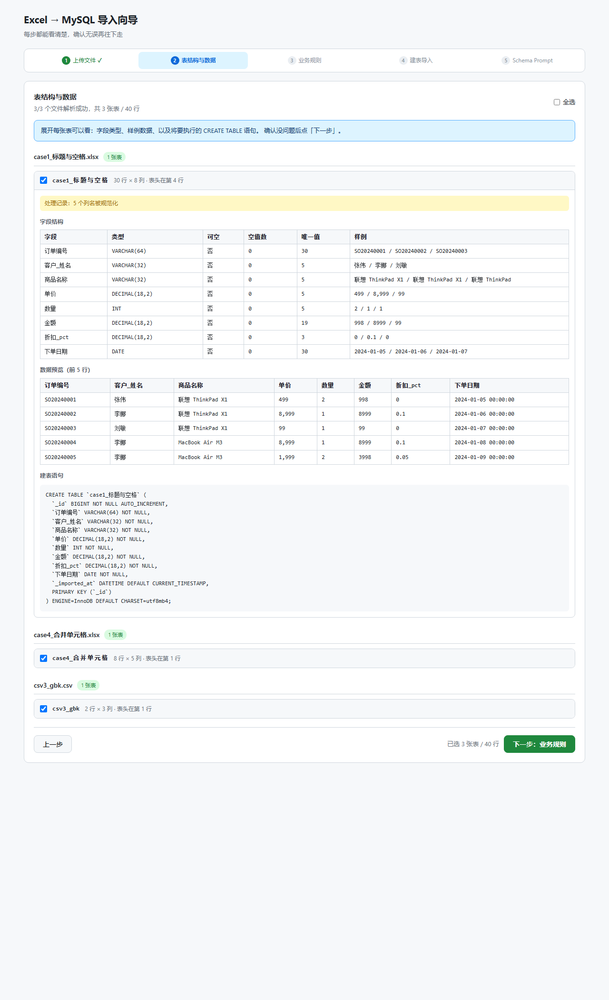

# excel2mysql

把 Excel 表格导入 MySQL，自动生成表结构，并输出可直接喂给 LLM 的 Schema Prompt。

为「拿到的 Excel 什么样都不知道」这个场景写的。

## 七种用法

| 场景 | 方式 | 写库 |
|---|---|---|
| **可视化向导** | `python webapp.py` → 浏览器，五步确认 | 勾选后写 |
| **一条命令跑完** | `python excel2mysql.py run "表.xlsx" --db mydb` | ✅ |
| **批量处理** | `python excel2mysql.py batch "文件夹\" --db mydb` | ✅ |
| 只看结构 | `python excel2mysql.py inspect "表.xlsx"` | ❌ |
| 只要建表 SQL | `python excel2mysql.py ddl "表.xlsx"` | ❌ |
| 预演（DDL + 数据样例） | `python excel2mysql.py preview "表.xlsx"` | ❌ |
| 生成 Schema Prompt | `python excel2mysql.py schema --db mydb` | ❌ |

**第一次用建议走可视化向导**：五步都有确认，能看清解析对不对、规则参数是否过期。
确认没问题后再用 CLI 批量处理。

- [快速开始](#快速开始) —— 装依赖 + 一条命令跑完
- [Web 界面](#web-界面推荐) —— 五步向导，含业务规则适配
- [业务规则适配](#业务规则适配为什么这么设计) —— 为什么只改参数不改判断
- [run 命令](#run-命令参数) —— 单文件全流程
- [batch 命令](#batch-命令批量处理) —— 多文件 / 目录 / 通配符
- [子命令详解](#子命令) —— inspect / ddl / preview / import / schema
- [CSV 支持](#csv-支持) —— 编码和分隔符探测
- [类型推断规则](#类型推断规则) —— 什么样的数据推成什么类型
- [接 Dify 工作流](#接-dify-工作流) —— Schema Prompt 怎么用
- [踩过的坑](#踩过的坑) —— 实现细节和踩过的雷

## CSV 支持

`.csv` 和 `.txt` 都走专门的解析路径，比 Excel 多做三件事：

| 处理 | 说明 |
|---|---|
| **编码自动探测** | 依次尝试 `utf-8-sig` / `utf-8` / `gb18030` / `gbk` / `latin1` |
| **分隔符自动探测** | 逗号 / 分号 / 制表符 / 竖线，按各行出现次数的稳定性判断 |
| **行长度容错** | 列数不一致时不崩溃，坏行跳过或补齐 |

### 实测通过的情况

| 情况 | 处理结果 |
|---|---|
| UTF-8 无 BOM | ✅ |
| UTF-8 带 BOM（Excel 另存为 CSV 的默认） | ✅ 识别为 `utf-8-sig` |
| GBK / GB18030 | ✅ 自动识别 |
| **分号分隔**（欧洲 Excel 默认） | ✅ 识别为「分号」 |
| **制表符分隔**（从 Excel 复制粘贴） | ✅ 识别为「制表符」 |
| 字段内含逗号（`"笔记本, 14寸"`） | ✅ 引号正确处理 |
| 字段内含换行 | ✅ |
| 标题行 + 空行在表头之前 | ✅ 自动找到真正的表头 |
| 行长度不一致（第 2 行 7 个字段，其他 6 个） | ✅ 不崩溃，按最大列数补齐 |
| 千分位 + 货币符号（`¥1,299.00`） | ✅ 解析为数字 |

**9 种 CSV 变体，全部通过解析和导入测试。**

### 探测逻辑

分隔符探测的做法：

1. 读前 30 个非空行
2. 对每个候选分隔符，统计每行的出现次数
3. 要求该分隔符在 **≥60% 的行** 出现
4. 计算次数的**方差**，越小越稳定
5. 综合评分选最优，同时检查列数在 2~50 的合理范围

这样能区分「正常的分号 CSV」和「逗号 CSV 里恰好有些字段含分号」。

编码探测：逐个尝试直到能读完 8KB 不报 `UnicodeDecodeError`。

**注意**：`utf-8-sig` 放在最前面，因为带 BOM 的文件用 `utf-8` 读也能成功，但会把 BOM 当成第一个字符的一部分（列名变成 `\ufeff姓名`）。

### 兜底的二级方案

如果 pandas 彻底读不了（比如引号不配对），会退化成「按行读、按分隔符切、补齐到最大列数」。这种兜底不处理引号内的分隔符，但至少不会整个失败。

## Web 界面（推荐）

五步向导，每步都能看清楚，确认无误再往下走。

### 配置（只需一次）

在项目目录建 `.env` 文件：

```ini
LLM_API_KEY=sk-xxx
LLM_API_BASE=https://api.siliconflow.cn/v1
LLM_MODEL=deepseek-ai/DeepSeek-V3
LLM_TIMEOUT=120

MYSQL_PASSWORD=123456
```

**之后直接启动就行，不用每次设环境变量：**

```bash
python webapp.py
```

打开 **http://127.0.0.1:8700**

页面顶部会显示配置状态：

```
● LLM 已配置  deepseek-ai/DeepSeek-V3  sk-crj…zest
● MySQL 已配置  配置来自 .env
```

没配对会显示红点和提示。

### 配置读取顺序

后面的覆盖前面的：

| 优先级 | 来源 |
|---|---|
| 1（最低） | 代码默认值 |
| 2 | `.env` / `.env.local` |
| 3 | `环境变量.txt` / `config.txt` |
| 4（最高） | 系统环境变量 |

所以你也可以临时用环境变量覆盖：

```powershell
$env:LLM_MODEL="Qwen/Qwen2.5-14B-Instruct"   # 临时换模型
python webapp.py
```

### 配置文件支持的格式

```ini
# 标准格式
LLM_API_KEY=sk-xxx
LLM_API_KEY: sk-xxx          # 冒号也行

set MYSQL_PASSWORD=123456    # Windows cmd 的写法也能认

sk-xxxxxxxxxxxx              # 单独一行，自动当成 LLM_API_KEY
```

**`.env` 和 `环境变量.txt` 都在 `.gitignore` 里**，不会被提交。

### 五个步骤

```
1. 上传文件      拖进来，支持多选
2. 表结构与数据   字段类型、样例数据、CREATE TABLE，确认解析对不对
3. 业务规则      原文展示 + 参数改动对照 + 表名映射，人看一遍确认
4. 建表导入      填数据库名，确认后写库
5. Schema Prompt 复制到 Dify
```

### 步骤 2：表结构与数据



每张表展开后能看到：

| 区块 | 内容 |
|---|---|
| 处理记录 | 哪些列名被规范化了、编码和分隔符是什么 |
| 字段结构 | 列名、推断类型、空值数、唯一值数、样例值 |
| 数据预览 | 前 5 行真实数据，空值显示 `NULL` |
| 建表语句 | 完整 DDL |

**这一步是确认解析质量的关键**：
- 表头认对了没有（图中显示「表头在第 4 行」）
- 类型推断合不合理（`单价` DECIMAL、`数量` INT）
- 中文有没有乱码

### 步骤 3：业务规则（核心）

把你手写的业务规则文档粘贴进来。系统做两件事，**都不改业务判断**。

#### 2.1 参数适配：只改「明确参数」

规则里有两类内容，处理方式完全不同：

| 类型 | 例子 | 处理 |
|---|---|---|
| **业务判断** | 「算销售额必须加 status='已完成'」 | ❌ 一个字不改 |
| **明确参数** | 「一级分类只有 4 个」「status 只有在售/下架」 | ✅ 按当前数据更新 |

系统会列出**每一处改动**，供你逐条核对：

| 类型 | 原文 | 改为 | 依据 |
|---|---|---|---|
| 数量 | 一级分类只有 4 个 | 一级分类有 6 个 | `category_level` 分布 `{"1":6,"2":12,"3":2}` |
| 取值 | 数码电器、服装鞋包... | 家用电器、手机数码... | `grouped_values["1"]` |
| 字段名 | `SUM(subtotal)` | `SUM(line_amount)` | 表中没有 subtotal，但有 line_amount |
| 枚举 | `'已完成'` | `'completed'` | order_status 实际值是 completed |
| 层级 | 「两级结构」 | 「三级结构」 | level 有 1/2/3 三档 |

**每处改动都带数据依据**，不是 LLM 随便写的。

#### 2.2 表名映射

规则里写的旧表名，对应到本库的实际表名：

```
categories  → 01_dim_category
customers   → 02_dim_customer
orders      → 04_fact_order
products    → 03_dim_product
```

用下拉框可以手动改。匹配不到的表（如 `shipments`）会标「需确认」，
**宁可留空让人选，也不乱配一张表**。

#### 2.3 三种视图切换

适配后的规则框右上角可以切换：

| 视图 | 用途 |
|---|---|
| 适配版（默认） | 直接看改成了什么 |
| 可编辑 | 觉得某处改得不对，手动改 |
| 原文 | 和原版对照 |

最后必须勾选「我已核对规则改动和表名映射」才能进下一步。

### 步骤 4：建表导入

填数据库名，确认后写库。**同名表会被 `DROP TABLE IF EXISTS` 重建。**

这一步还能指定 **Prompt 保存位置**：

| 填法 | 结果 |
|---|---|
| 填一个目录路径 | 存到该目录（不存在会自动创建）|
| 点「用默认」 | demo 模式会填入源数据目录；浏览器上传填不了（安全限制）|
| 留空 | 存到项目的 `_uploads/` 目录 |

**为什么要手填**：浏览器上传文件时，服务端只知道文件内容，不知道原文件在磁盘哪个目录。
所以想「跟 Excel 放一起」，需要手动粘一下路径，例如：

```
E:\dify实战\excel2mysql\testdata
```

生成的文件名是 `schema_prompt_<库名>.txt`。

### 步骤 5：Schema Prompt

生成完整 Prompt，包含：

```
## ⚠️ 业务规则（必须严格遵守）
[适配后的规则全文]

### 表名对照
- categories → 01_dim_category

---

## 表间关系（JOIN 用）
- 05_fact_order_item.order_id → 04_fact_order.order_id

## 表：01_dim_category（约 20 行）
[字段、类型、枚举]

## 生成 SQL 的注意事项
[7 条约束]
```

点「复制」粘到 Dify 的 LLM 节点 System Prompt。

---

## 陷阱检测（已接入 Prompt 生成）

NL2SQL 最容易错的地方不是语法，是**业务陷阱**：

- 数据是历史快照，用 `CURRENT_DATE()` 查「上个月」返回 0 行
- 订单 JOIN 明细后 `SUM(total_amount)` 翻倍
- 5 张表都有金额字段，不知道「销售额」指哪个

这些**程序能测出来**，不需要 LLM 猜。

### 用法

```bash
# 生成 Prompt 时带上陷阱检测
python excel2mysql.py schema --db mydb --with-traps --out prompt.txt

# 同时把详细结果单独存一份，便于人工复核
python excel2mysql.py schema --db mydb --with-traps --traps-out traps.txt

# 单独跑检测（不生成 Prompt）
python detect_traps.py --db mydb --out traps.txt
```

Web 向导第 5 步**默认就会跑**，页面上会显示命中了几条、哪些需要人工确认。

### 10 条检测项

| # | 陷阱 | 检测方式 | 命中后 Prompt 里写什么 |
|---|---|---|---|
| 1 | 自引用外键 | 扫 `parent_id` 等惯用名 | 层级结构 + 需多次自连接 |
| 2 | 外键指向非叶子层级 | JOIN 查实际分布 | 完整上卷路径 + 重复计数警告 |
| 3 | 金额分散多表 | 扫 DECIMAL 字段 | 全部金额字段清单 + 口径冲突警告 |
| 4 | 汇总 vs 明细不一致 | **跑对比 SQL** | 一致/不一致 + 差异样例 |
| 5 | 退款表 | 表名匹配 | 退款表清单 + 需人工确认口径 |
| 6 | 逻辑删除 | 字段名 + 取值验证 | 过滤条件 |
| 7 | 状态枚举含未完成态 | `SELECT DISTINCT` | 全部值 + 已完成/未完成分组 |
| 8 | **历史快照** | **`MAX(时间)` 对比今天** | 正确/错误 SQL 对照 |
| 9 | 1:N 关系 | 唯一值/行数比值 | 膨胀倍数 + 正确聚合写法 |
| 10 | 排名/评分字段 | 字段名（排除 level） | 破平规则需人工确认 |

### 实测结果（11 张电商表，10/10 命中）

```
[8] 历史快照 —— 命中
    fact_order.order_time: MAX=2026-06-01（距今 169 天）
    → 相对时间必须基于 MAX(时间列)，禁用 CURRENT_DATE()

[9] 1:N 关系 —— 命中
    fact_order_status_log.order_id: 11 唯一 / 43 行（平均 3.9 条重复）
    → SUM 前必须先按主键聚合
```

Prompt 里会给出这样的对照：

```sql
-- ✅ 正确：以数据最新时间为基准
WHERE order_time >= (SELECT DATE_SUB(MAX(order_time),
                                   INTERVAL 3 MONTH) FROM fact_order)

-- ❌ 错误：用现实时间，会返回 0 行
WHERE order_time >= DATE_SUB(CURRENT_DATE(), INTERVAL 3 MONTH)
```

### 设计原则：程序检测，不让 LLM 猜

**这是踩过坑才定下来的。**

最初让 LLM 自己「检查陷阱」，它编造了不存在的分类名（实测编出「图书音像」）。改成程序检测后：

```
程序跑 SQL → 得到事实 → 直接拼进 Prompt
```

**结果不经过 LLM，准确率 100%。**

### 检测不准时会怎样

**宁可漏报，不要误报。** 因为误报会让 LLM 写出错误的约束。

实测修掉的 3 个误报：

| 陷阱 | 曾经的问题 | 现在的做法 |
|---|---|---|
| 4 | `total_amount` 对比 `discount_amount`（语义不合理）| 严格白名单配对 |
| 8 | 把 `birthday`（距今 9654 天）当快照 | 排除 birth/expire，只认业务时间 |
| 10 | `category_level`、`member_level` 当评分 | 排除含 level/tier 的字段 |

**认不出就写「未发现」，不要瞎配。** 这是宁可缺也不要错。

### 标了「需人工确认」的项

这些程序判断不了，Prompt 里会原样标注：

- **退款是否冲减销售额**（陷阱 5）
- **哪些状态算「成交」**（陷阱 7）
- **排名并列时的破平规则**（陷阱 10）

LLM 看到「需人工确认」会先反问，而不是自己假设。

### 检测出错时怎么办：换强模型复核

**检测层是规则驱动的，规则写死就会有盲区。** 遇到以下情况，说明检测结果不可全信：

| 现象 | 可能原因 |
|---|---|
| 陷阱 2/4/9 显示「未发现」，但你确信库里有 | 字段命名不在白名单里（如 `amt` / `sub_amt`） |
| 陷阱 4 的配对明显不对（父表汇总对上了子表折扣） | 白名单碰巧撞上，属于误报 |
| 陷阱 7 的「已完成态」分组不符合业务 | 关键词表覆盖不全（如 `settled` / `archived` 没收录） |
| 命中数明显偏低（< 5 条） | 这套库命名不规范，规则大面积失效 |

**建议做法：检测结果出来后，用更强的模型复核一遍，只让它做「评价+补充」，不重写结论。**

流程：

```
程序检测 → traps.txt（事实清单）
              ↓
       强模型复核（如 DeepSeek-V3 / GPT-4 级别）
              ↓
       输出「补充项」和「存疑项」
              ↓
       人工判断是否采纳
```

**复核用的 prompt 可以是这样：**

```
下面是一份程序生成的数据陷阱检测结果，以及对应的 DDL。

你的任务是**复核**，不是重写：

1. 找出检测结果里**明显漏掉**的陷阱（对照 10 条标准逐条看）
2. 找出检测结果里**明显错误**的条目（如字段配对语义不合理）
3. 对「需人工确认」的项，说明为什么程序判断不了

约束：
- 只输出「补充」和「存疑」两类内容
- 不要重复检测结果里已有的正确条目
- 结论必须能落到具体的 表.字段 上，落不到就不要提
- 不确定的标「存疑」，不要下断言
```

**注意几条前提：**

- 强模型只做**评价和补充**，不要让它直接改 Prompt —— 它会编造字段名（实测过）
- 复核结果**必须人工过一遍**再采纳
- 复核成本不低（一次几毛到几块），只在「检测结果明显不对劲」时用

**不建议每次都复核。** 规则检测在命名规范的库上准确率足够高，只有换了一套陌生命名风格时才需要补一次。

**长期更好的做法**：把复核发现的漏报模式沉淀回 `detect_traps.py` 的白名单，让程序越用越准，而不是每次依赖大模型。

## 表间关系与表名映射

### 三个来源，各有分工

| 来源 | 负责什么 | 实测覆盖 |
|---|---|---|
| **规则检测** | 表间外键关系 | 12/13（92%）|
| **LLM 推断** | 表间关系 + 表用途 | 13/13（100%）|
| **规则提取** | 旧表名 → 实际表名 | 只覆盖规则提到的表 |
| **人工确认** | 映射到底对不对 | 界面上逐个可改 |

**表间关系 = 规则 + LLM 并集**，实测 13/13 覆盖、0 误报。

### 表间关系：为什么两个来源都要

规则靠「列名实体能匹配表名」判断，很准但会漏：

```
categories.parent_id → categories.category_id    ← 自关联，规则漏了
```

LLM 看到了真实数据（`parent_id` 的值能对应到 `category_id`），补上了这条。

**两个来源取并集，覆盖最全。**

### 表名映射：只覆盖规则提到的表

业务规则通常只提到几张核心表：

```
categories  → 01_dim_category
customers   → 02_dim_customer
order_items → 05_fact_order_item
orders      → 04_fact_order
products    → 03_dim_product
```

但这不代表库里只有 5 张表。剩下 5 张从没在规则里出现过：

| 表 | 规则提过吗 |
|---|---|
| `06_fact_payment` | ❌ |
| `07_fact_shipment` | ❌ |
| `08_fact_refund` | ❌ |
| `09_fact_review` | ❌ |
| `10_fact_order_status_log` | ❌ |

### 所以 Prompt 里会补一节「其他可用的表」

```markdown
### 其他可用的表（优先级低于上面规则提到的表）

业务规则里没提到，但库里确实存在。使用时遵守以下规则：

1. **优先用业务规则提到的那几张表**。能用规则里的表回答的，不要用这些
2. 只有当问题必须用到这些表时才使用
   例：问「有多少订单退款了」→ 规则里的表查不到退款，才用 `08_fact_refund`
   例：问「这个月卖了多少」→ 用规则里的订单+明细，不要用 `06_fact_payment`
3. 用这些表时，JOIN 条件按下面「表间关系」里的关系写
4. 不要在业务规则没有明确要求时，把这些表 JOIN 进来

| 表名 | 用途 | 行数 |
|---|---|---|
| `06_fact_payment` | 支付记录表 | 19 |
| `07_fact_shipment` | 物流配送表 | 15 |
| `08_fact_refund` | 退款退货表 | 6 |
| `09_fact_review` | 商品评价表 | 16 |
| `10_fact_order_status_log` | 订单状态日志表 | 43 |
```

**用途是 LLM 从字段内容推断的**（看到 `pay_no`/`pay_amount`/`pay_time` 就知道是支付表）。

**加了优先级约束**，避免 LLM 拿到更多表后乱用。

### 实测数据

| 项 | 结果 |
|---|---|
| 表间关系覆盖 | 13/13（规则 12 + LLM 1）|
| 表间关系误报 | 0 |
| 表名映射 | 5 个全部正确匹配 |
| 表用途覆盖 | 10/10 张表 |
| Prompt 长度 | 9713 字符（10 张表）|

### 人工确认的边界

| 内容 | 能否自动 |
|---|---|
| 表间外键关系 | ✅ 规则 + LLM 都能做 |
| 表用途说明 | ✅ LLM 能推断 |
| 旧表名 → 实际表名 | ⚠️ 能提建议，**必须人工确认** |
| 业务口径（销售额用哪个字段）| ❌ 只能人定 |

**`customers` 到底对应哪张表，只有业务方知道。** 所以界面上保留下拉框可以改。

## 业务规则适配：为什么这么设计

### 问题

手写的业务规则通常是照着某套数据写的。换一批数据，里面的事实全错了：

```
你写的：一级分类只有 4 个：数码电器、服装鞋包、食品生鲜、家居日用
实际的：一级分类有 6 个：手机数码、家用电器、服饰鞋包、食品生鲜、美妆个护、母婴玩具
```

直接塞给 LLM，它会照着错误事实写 SQL，查「数码电器」返回空。

### 但不能让 LLM 随便改

规则里有**业务判断**，那是人的经验，机器改了就是篡改基准：

```
「算销售额必须加 status='已完成'」
「商品销售额不能用 SUM(pay_amount)，JOIN 明细会重复累加」
```

### 解法：区分两类内容

| 类型 | 判断依据 | 处理 |
|---|---|---|
| **业务判断** | 说的是「应该怎么做」 | 原样保留 |
| **明确参数** | 出现具体数字/值/名字 | 对照真实数据更新 |

**并且每处改动都要给出数据依据**，人能逐条核对。

### 踩过的坑：LLM 会编造数据

第一次实现时，只给了 `category_name` 的 20 个值，没告诉它哪些属于哪个层级。
LLM 直接编了：

```
改为: 数码电器、服装鞋包、食品生鲜、家居日用、美妆个护、图书音像
                                                        ↑ 数据里没有这个
```

**修法**：按层级分组给值。

```json
"grouped_values": {
  "1": ["家用电器", "手机数码", "服饰鞋包", "母婴玩具", "美妆个护", "食品生鲜"],
  "2": ["休闲零食", "厨房小电", "大家电", ...],
  "3": ["手机配件", "智能手机"]
}
```

有了这个，LLM 只能从真实列表里取值，改出来是：

```
改为: 家用电器、手机数码、服饰鞋包、母婴玩具、美妆个护、食品生鲜
依据: grouped_values["1"]: [...]
```

### 实测：15 处改动，全部有据

用一套含大量错误参数的规则测试（10 张电商表）：

| 类型 | 数量 | 例子 |
|---|---|---|
| 表名 | 5 | `customers` → `02_dim_customer` |
| 字段名 | 3 | `subtotal` → `line_amount` |
| 数量 | 2 | 一级分类 4→6，二级 6→12 |
| 取值 | 4 | 分类名、订单状态全部换成真实值 |
| 层级 | 1 | 「两级」→「三级」 |

**业务判断零改动**，「绝不能用 SUM(pay_amount)」这类规则原样保留。

---

## Web 界面支持的其他功能

### 选择性导入

步骤 2 每张表前面有勾选框，顶部有「全选」。**没勾选的表不会建。**

一个文件有多个 sheet 时，每个 sheet 是一张表，可以单独勾选。

### 演示模式

想直接看界面效果，不用准备文件：

```
http://127.0.0.1:8700/?demo=case1_标题与空格.xlsx
```

逗号分隔可以加载多个。只对 `testdata/` 里已存在的文件生效。

### 端口和上传目录

| 项 | 默认值 | 改法 |
|---|---|---|
| 端口 | 8700 | `$env:WEB_PORT=8800` |
| 上传临时目录 | `_uploads/` | 改代码里的 `UPLOAD_DIR` |

上传的文件会留在 `_uploads/` 里，可以定期清理（已在 `.gitignore` 里排除）。

---

## 业务规则审查（CLI 版）

除了向导里的适配，还有一个独立的审查命令，只检查不改：

```bash
python excel2mysql.py run "数据.xlsx" --db mydb --notes 业务红线.md
```

生成的 Prompt 会把业务规则放在最前面（优先级高于表结构）。

| 参数 | 说明 |
|---|---|
| `--notes` | 业务规则文件路径（Markdown） |
| `--adapt-notes` | 让 LLM 把规则里的旧表名换成本次实际的 |

```bash
# 只是合并，不改规则（快，零风险）
python excel2mysql.py schema --db mydb --notes 业务红线.md

# 合并 + 适配表名（慢约 80 秒）
python excel2mysql.py schema --db mydb --notes 业务红线.md --adapt-notes
```

**注意**：CLI 的 `--adapt-notes` 只换表名，不做参数核对。
需要参数核对请用 Web 界面的步骤 3。

---


## 为什么需要它

现场给你一个 Excel，让你导入数据库再做大模型查询。问题在于：

- 表头前可能有标题行、说明行、空行，你不知道真正的表头在第几行
- 列名可能带空格、换行、全角括号、百分号、货币符号
- 列名可能重复、为空、是 MySQL 保留字（`order`、`desc`、`select`）
- 数字可能存成了文本，还带千分位和「元」字后缀
- 日期格式会混着来：`2024-01-01`、`2024/1/1`、`2024年1月1日`、Excel 日期对象
- 可能用合并单元格，合并后只有左上角有值
- 可能有合计行、小计行
- CSV 可能是 GBK 编码

这个脚本对上面每一条都做了处理。

## 快速开始

### 一条命令跑完（推荐）

```bash
# 装依赖（建议独立虚拟环境，避免影响系统 pandas）
python -m venv .venv
.venv\Scripts\activate          # Windows
pip install -r requirements.txt

# 一条命令：解析表头 → 建库建表 → 灌数据 → 生成 Schema Prompt
set MYSQL_PASSWORD=你的密码
python excel2mysql.py run "数据.xlsx" --db mydb
```

输出：

```
========================================================================
  Excel → MySQL 全流程
  文件: 数据.xlsx
  目标库: mydb
========================================================================

[1/5] 解析 Excel
      sheet '销售报表': 表头第 4 行，30 行 x 8 列
        · 5 个列名被规范化
      合计 1 个 sheet，30 行

[2/5] 准备数据库
      库 `mydb` 就绪

[3/5] 建表
      `sales`  8 列  (DATE×1 DECIMAL×1 INT×1 SMALLINT×1 TINYINT×1 VARCHAR×3)

[4/5] 写入数据
      `sales`  写入 30 行

[5/5] 生成 Schema Prompt
      已写入 schema_prompt.txt（774 字符）

========================================================================
  完成
========================================================================
  库: mydb
  表: 1 个，数据: 30 行
  耗时: 1.0s
```

**实测 5 个脏 Excel，全部 1 秒左右跑完。**

### 分步执行（看清每一步）

如果想知道中间发生了什么，可以分步来：

```bash
# 1. 先看 Excel 长什么样（不写库）
python excel2mysql.py inspect "数据.xlsx"

# 2. 预演：看清会建什么表、什么类型（仍不写库）
python excel2mysql.py preview "数据.xlsx" --table sales

# 3. 只拿建表 SQL，自己执行
python excel2mysql.py ddl "数据.xlsx" --table sales

# 4. 真正导入
python excel2mysql.py import "数据.xlsx" --table sales --db mydb

# 5. 生成给 LLM 的 Schema Prompt
python excel2mysql.py schema --db mydb --out schema_prompt.txt
```

## `run` 命令参数

```bash
python excel2mysql.py run "数据.xlsx" --db mydb
```

| 参数 | 说明 | 默认 |
|---|---|---|
| `file` | Excel/CSV 路径（必填） | — |
| `--db` | 目标库（必填，不存在会自动建） | — |
| `--sheet` | 指定 sheet（名字或索引） | 全部 |
| `--table` | 表名。单 sheet 直接用；多 sheet 作前缀加序号 | 用 sheet 名 |
| `--chunk` | 每批写入行数 | 1000 |
| `--no-id` | 不要自增主键 `_id` | 加 |
| `--no-ts` | 不要 `_imported_at` | 加 |
| `--out` | Schema Prompt 输出路径 | Excel 同目录 |

**多个 sheet 时**：

```bash
# 会建三张表：数据_1、数据_2、数据_3
python excel2mysql.py run "多sheet.xlsx" --table 数据 --db mydb

# 不给 --table，就用 sheet 名当表名
python excel2mysql.py run "多sheet.xlsx" --db mydb
```

## 子命令

### `run` —— 一条命令跑完全流程

```bash
python excel2mysql.py run "数据.xlsx" --db mydb
```

依次做五件事，任何一步失败就停下并打印原因：

1. **解析** —— 探测表头在第几行，规范化列名，清洗数据
2. **建库** —— 不存在则创建（utf8mb4）
3. **建表** —— 按推断的类型生成 `CREATE TABLE`
4. **灌数据** —— 分批写入，NaN 转 NULL
5. **生成 Schema** —— 输出 `schema_prompt.txt`

**失败时会在哪一步停下**：

| 失败场景 | 报错 |
|---|---|
| 文件不存在 / 格式不支持 | `文件不存在` / `不支持的文件类型` |
| 加密的 Excel | `打不开 Excel（openpyxl）：...` |
| 所有 sheet 都没数据 | `所有 sheet 都解析不出数据` |
| 建表失败（如列名冲突） | `` 建表 `xxx` 失败：... `` |
| 写入失败（如类型不匹配） | `` 写入 `xxx` 失败：... `` |

**不会留下半成品**：建表失败时前面的表已建好但数据没灌，重跑一次会 `DROP` 重建。

### `inspect` —— 只看不写

探测每个 sheet 的表头位置、清洗后尺寸、每列的推断类型和样例值。

```
[1] sheet = '销售报表'
    原始尺寸: 34 行 x 8 列
    表头位置: 第 4 行（可信度 0.98）
    处理记录: 5 个列名被规范化
    清洗后: 30 行 x 8 列

    列名                 推断类型          非空    唯一值   样例
    ------------------------------------------------------------------
    订单编号              VARCHAR(46)      30     30     SO20240001 / SO20240002
    客户_姓名             VARCHAR(32)      30      5     张伟 / 李娜
    单价                  SMALLINT         30      5     499 / 8,999
    折扣_pct              DECIMAL(18,2)    30      3     0 / 0.1
    下单日期              DATE             30     30     2024-01-05 / 2024-01-06
```

**先跑这个**。看清楚它认的表头对不对、类型推断合不合理，再决定要不要导入。

### `ddl` —— 只要建表语句

不想让脚本建表，只想拿一段 SQL 自己执行：

```bash
python excel2mysql.py ddl "数据.xlsx" --table sales
```

输出（纯 SQL，无装饰，可直接复制）：

```sql
CREATE TABLE `sales` (
  `_id` BIGINT NOT NULL AUTO_INCREMENT,
  `订单编号` VARCHAR(46) NOT NULL,
  `客户_姓名` VARCHAR(32) NOT NULL,
  `商品名称` VARCHAR(48) NOT NULL,
  `单价` SMALLINT NOT NULL,
  `数量` TINYINT NOT NULL,
  `金额` INT NOT NULL,
  `折扣_pct` DECIMAL(18,2) NOT NULL,
  `下单日期` DATE NOT NULL,
  `_imported_at` DATETIME DEFAULT CURRENT_TIMESTAMP,
  PRIMARY KEY (`_id`)
) ENGINE=InnoDB DEFAULT CHARSET=utf8mb4 COLLATE=utf8mb4_unicode_ci;
```

**多 sheet 会输出多段 DDL**，每段之间空一行。

| 参数 | 说明 |
|---|---|
| `--out` | 写到文件而不是打印 |
| `--no-id` | 不要自增 `_id` 列 |
| `--no-ts` | 不要 `_imported_at` 列 |

### `preview` —— 预演建表 + 数据样例

除了 DDL，还打印转换后的前几行数据，能看出类型转换有没有问题。

```bash
python excel2mysql.py preview "数据.xlsx" --table sales
```

### `import` —— 真正导入

```bash
python excel2mysql.py import "数据.xlsx" --table sales --db mydb
```

| 参数 | 说明 |
|---|---|
| `--sheet` | 指定 sheet（名字或索引），默认全部 |
| `--table` | 表名。只有一个 sheet 时直接用；多个 sheet 时作为前缀加序号 |
| `--db` | 目标库（不存在会自动创建） |
| `--chunk` | 每批写入行数，默认 1000 |
| `--no-id` | 不加自增主键 `_id` |
| `--no-ts` | 不加 `_imported_at` 时间戳 |
| `--save-schema` | 把每张表的 schema 存成 JSON |

**默认会加两个辅助列**：

- `_id`：自增主键，方便定位单行
- `_imported_at`：导入时间

这两个列在生成 Schema Prompt 时会自动排除（不干扰 LLM）。

⚠️ **导入是 `DROP TABLE IF EXISTS` 再重建**。同名的表会被覆盖。

### `batch` —— 批量处理多个文件

```bash
# 目录（递归找所有 xlsx/xls/csv）
python excel2mysql.py batch "D:\面试数据\" --db mydb

# 通配符
python excel2mysql.py batch "data\*.xlsx" --db mydb

# 多个文件
python excel2mysql.py batch "1月.xlsx" "2月.csv" "3月.xlsx" --db mydb

# 混用
python excel2mysql.py batch "data\" "extra\*.csv" "单个.xlsx" --db mydb
```

| 参数 | 说明 | 默认 |
|---|---|---|
| `paths` | 文件 / 目录 / 通配符，可给多个 | — |
| `--db` | 目标库 | 必填 |
| `--prefix` | 表名前缀 | 用文件名 |
| `--chunk` | 每批写入行数 | 1000 |
| `--no-id` | 不要自增主键 | 加 |
| `--no-ts` | 不要 `_imported_at` | 加 |
| `--out` | Schema Prompt 路径 | 第一个文件同目录 |

**核心特性：一个文件失败不影响其他。**

实测混入损坏文件、空文件、只有表头的文件：

```
[1/5] broken.xlsx
      ✗ 解析失败，跳过
[2/5] empty.csv
      ✗ 解析失败，跳过
[3/5] good1.csv
      ✓ `good1`  3 列  2 行
[4/5] good2.csv
      ✓ `good2`  3 列  2 行
[5/5] header_only.csv
      - 无数据，跳过

文件: 2 成功 / 3 失败 / 共 5
```

**自动跳过的东西**：

| 文件 | 处理 |
|---|---|
| `schema_prompt.txt`（本工具生成的） | 跳过，不会当数据导入 |
| `.md` / `.json` / `.py` | 扩展名过滤 |
| 损坏的 xlsx | 记录失败，继续下一个 |
| 空文件 | 记录失败，继续 |
| 只有表头没数据 | 记录「无数据」，继续 |

**返回码**：全成功 0，有失败 1。


### 表名规则

| 情况 | 表名 |
|---|---|
| 单个 sheet 的 `1月销售.xlsx` | `1月销售` |
| 多 sheet 的 `数据.xlsx`（含 Sheet1/Sheet2） | `数据_Sheet1`、`数据_Sheet2` |
| 加了 `--prefix 面试` | `面试_1月销售` |
| 文件名含空格/特殊字符 | 自动规范化 |

**返回码**：全部成功是 0，有失败是 1（方便脚本判断）。

### `schema` —— 生成 LLM 用的 Prompt
```bash
python excel2mysql.py schema --db mydb --out schema_prompt.txt
```

输出长这样：

```markdown
# 数据库表结构（库名：mydb，MySQL 8.0）

## 表：sales（约 30 行）

| 字段 | 类型 | 可空 | 样例值 |
|---|---|---|---|
| `订单编号` | VARCHAR(46) | 否 | SO20240001 / SO20240002 |
| `客户_姓名` | VARCHAR(32) | 否 | 张伟 / 李娜 |
| `金额` | INT | 否 | 998 / 8999 |
| `下单日期` | DATE | 否 | 2024-01-05 / 2024-01-06 |

## 生成 SQL 的注意事项
1. 只输出单条 SELECT，禁止写操作
2. 不要用 SELECT *
3. 字符串匹配默认用 LIKE
...
```

**样例值这一列很关键**。LLM 看到 `客户_姓名` 的实际值是「张伟 / 李娜」，就知道该用中文名去匹配，不会去猜字段含义。

## 接 Dify 工作流

生成的 `schema_prompt.txt` 直接粘进 LLM 节点的 System Prompt：

```
你是一个 MySQL 8.0 数据查询专家。把用户的问题转换成单条 SELECT 语句。

{schema_prompt.txt 的全部内容}

只输出 SQL，不要 Markdown 标记，不要分号。
```

工作流结构：

```
用户输入 → LLM(生成SQL) → SQL Query → IF/ELSE → LLM2(解读) → 输出
                                        ↓
                                    执行失败 → 错误提示
```

**表数量少（< 20 张）时推荐这种静态注入**，因为：

- 表结构能塞进上下文（5 张表约 400 token，云端模型支持 64K）
- 100% 保证 LLM 看到全部表，不会像 RAG 那样漏表
- 改表结构时重新生成一次 `schema_prompt.txt` 就行

**表数量超过 20 张**时再考虑 RAG 检索表结构。

## 类型推断规则

### 核心原则：schema 不能随样本变化

**这个问题比单个字段类型错了更严重。**

最初只按数据判断类型，结果同一张表里：

```
list_price    SMALLINT        ← 20 行恰好都是整数
sale_price    DECIMAL(18,2)   ← 有一行 89.90
cost_price    SMALLINT        ← 20 行恰好都是整数
```

三个字段业务含义一样，类型却不同。**只因为 `sale_price` 里有一行带小数点。**

删掉那一行，三个全变 SMALLINT；加一个 9.9 元的商品，三个全变 DECIMAL。

**这意味着同一份数据换个样本，得到的表结构就变了。** 批量入库时这是致命的——今天跑通了，下个月换个文件又得重新检查类型。

### 修复：按列名语义决定类型

列名有明确语义的，**按语义定类型，不看数据**：

| 语义 | 识别关键词 | 强制类型 |
|---|---|---|
| **金额** | price / cost / amount / fee / total / discount / 价格 / 金额 / 成本 | `DECIMAL(18,2)` |
| **ID** | id / no / code / sku / 编号 / 编码 | 至少 `INT` |
| **数量** | qty / quantity / stock / 数量 / 库存 | `INT` |
| **电话** | mobile / phone / tel / 手机 / 电话 | `VARCHAR(32)` |
| **邮箱** | email / mail / 邮箱 | `VARCHAR(128)` |
| **状态/类型/名称** | type / status / name / reason / 类型 / 状态 / 名称 | `VARCHAR(32)` |

**判断优先级**（顺序很重要）：

```
phone → email → id → texty → money → count → other
```

为什么这个顺序：

- `mobile` 是纯数字，但要走 `phone` 先拦住，否则会变成 BIGINT（丢前导 0）
- `category_id` 同时含 "category"（texty）和 "id"，要 ID 优先，否则变成文本
- `refund_type` 含 "refund"（曾放在 money 里），要 texty 优先，否则变成 DECIMAL

列名看不出语义的，才退回看数据。

### 数值类型的第二道防线

即使看数据，也**不再选最小类型**：

| 情况 | 类型 | 理由 |
|---|---|---|
| 有小数 | `DECIMAL(18,2)` | — |
| 整数 + 语义是 ID | `INT` 起 | TINYINT 上限 127、SMALLINT 上限 32767，太容易溢出 |
| 整数 + 其他 | `INT` 起 | 同上 |

**宁可多占 1~2 字节，也不埋溢出隐患。** 溢出出问题时通常在生产环境。

### VARCHAR 长度也用标准档位

不用 `平均值×2+16`（样本一变长度就变），改成按**最大长度**取标准档位：

```
max_len ≤ 32   → VARCHAR(32)
max_len ≤ 64   → VARCHAR(64)
max_len ≤ 128  → VARCHAR(128)
max_len ≤ 255  → VARCHAR(255)
max_len ≤ 2000 → VARCHAR(2000)
更长           → TEXT / LONGTEXT
```

### 完整推断流程

```
有 95% 以上的值能解析成数字？
  ├─ 是 → 看列名语义
  │       ├─ phone  → VARCHAR(32)
  │       ├─ money  → DECIMAL(18,2)     ← 不管有没有小数
  │       ├─ id     → INT / BIGINT
  │       └─ 其他   → 有小数则 DECIMAL，否则 INT
  └─ 否 → 有 95% 以上的值能解析成日期？
          ├─ 是 → 有时分秒则 DATETIME，否则 DATE
          └─ 否 → 按语义和最大长度选 VARCHAR / TEXT
```

### 验证方法

```bash
# 逐行删除、随机抽样，看类型会不会变
python -c "
import excel2mysql as core
df = core.read_excel_robust('data.csv')[0].df
base = {p.name: p.dtype for p in core.profile_table(df)}
for i in range(len(df)):
    got = {p.name: p.dtype for p in core.profile_table(df.drop(index=i))}
    if got != base:
        print(f'删第 {i} 行后变了: {base} -> {got}')
"
```

**实测结果**（10 张电商表）：删掉任意一行、随机抽 30%/50%/80% 行、加一行 `0.01` 的金额、加一个 `999999` 的 ID，**类型全部不变**。

### 已知的误判情况

| 情况 | 结果 | 处理 |
|---|---|---|
| `20240101` 这种 8 位数字 | 判成 INT 而不是 DATE | 手动改成 DATE |
| `001`、`002` 这种编码 | 判成 INT，前导 0 丢失 | 在 Excel 里设成文本，或导入后改列类型 |
| `is_deleted`、`has_image` 这种 0/1 标志 | 判成 INT | 可接受，MySQL 没有 BOOLEAN 原生类型 |
| 列名全是中文且无关键词 | 退回看数据 | 靠数据判断，稳定性略差 |

### LLM 推断的边界：只管语义，不改类型

**LLM 判断「这个字段是什么意思」是强项，判断「该用什么数据库类型」是弱项。**

所以设计上做了严格划分：

| 内容 | 谁决定 | 理由 |
|---|---|---|
| 字段中文说明 | **LLM** | 人的语言理解 |
| 枚举值翻译 | **LLM** | `SHIP` → 已发货 |
| 表用途说明 | **LLM** | 从字段内容推断 |
| **MySQL 类型** | **数据推断**（LLM 只在 3 种情况能改）| LLM 会错 |

#### 踩过的坑：rating 被建成 VARCHAR(64)

LLM 把 `rating`（1~5 的整数）标成 `semantic=status`，
程序按 `status → VARCHAR(64)` 强制转换。

后果：

```sql
ORDER BY rating        -- 变成字符串排序，"10" < "2"
AVG(rating)            -- 直接报错
```

**根因**：程序无条件信任 LLM 的语义标签来定类型。

#### 现在的规则：只有 3 种情况 LLM 能改类型

| 语义 | 允许的改动 | 为什么 |
|---|---|---|
| `money` | 数值列 → `DECIMAL(18,2)` | 防止 `89.9` 被截断成 `89` |
| `phone` / `email` | 数值列 → `VARCHAR` | 手机号当整数会丢前导 0 |
| `id` | 数值列按值域调 `INT` / `BIGINT`；文本保持文本 | 不改变数值/文本的本质 |

**其他所有语义（`status`、`count`、`name`、`bool`…）一律不改类型。**

原因：

- `status` 不一定是文本 —— `rating` 1~5 就是数值
- `count` 不一定是 INT —— 可能原本是 DECIMAL
- 类型推断已经看过全部数据了，比 LLM 的语义标签更可靠

#### 唯一例外：`text` 会升级到 TEXT

```python
# 评价内容当前只有 19 字符 → VARCHAR(32)
# 但真实业务里可能有几百字
if semantic == "text" and 当前是 VARCHAR 且容量 ≤ 255:
    升级到 TEXT
```

**理由是当前样本太短，没体现出真实长度**，这跟「LLM 猜类型」是两回事。

#### 修复后效果

```
字段              修复前          修复后
rating           VARCHAR(64)     INT          ← 能正确排序和求平均
content          VARCHAR(32)     TEXT         ← 不会截断长评价
```

### 值解析的细节

**数字解析会处理**：千分位逗号（`1,299`）、货币符号（`¥$€`）、单位后缀（`元块`）、百分号（`35.4%` → `0.354`）。

**日期解析会处理**：`2024-01-01`、`2024/1/1`、`2024.1.1`、`2024年1月1日`、`15/08/2020`、Excel 日期对象、带时分秒的格式。

## 列名规范化

| 原始 | 处理结果 | 规则 |
|---|---|---|
| ` 订单编号 ` | `订单编号` | 去首尾空格 |
| `客户 姓名` | `客户_姓名` | 空格→下划线 |
| `金额（元）` | `金额` | 去掉括号内容 |
| `折扣%` | `折扣_pct` | 百分号→`_pct` |
| `order` | `order_col` | MySQL 保留字加后缀 |
| `名称`、`名称` | `名称`、`名称_2` | 重名加序号 |
| `（空）` | `col_5` | 空名给默认名 |
| `2024销售` | `n_2024销售` | 数字开头加前缀 |

## 测试

仓库里带了 5 个「脏 Excel」和回归测试：

```bash
# 生成测试文件
python make_dirty.py testdata

# 跑回归测试（inspect + import + 数据校验）
set MYSQL_PASSWORD=你的密码
python run_tests.py
```

测试覆盖：

| 文件 | 测什么 |
|---|---|
| `case1_标题与空格.xlsx` | 标题行 + 说明行 + 空行、脏列名、千分位、Excel 日期 |
| `case2_数字是文本.xlsx` | 货币符号、`元` 后缀、百分号、合计行、混合类型列 |
| `case3_重复列名.xlsx` | 重复列名、空列名、MySQL 保留字、全空列 |
| `case4_合并单元格.xlsx` | 合并单元格前向填充、6 种日期格式混用、空值 |
| `case5_gbk编码.csv` | GBK 编码自动识别 |

实测结果：**15/15 通过**（5 个文件 × 3 个阶段）。

## 踩过的坑

**问题 1：`pandas 2.x` 的 `df.where(pd.notna(df), None)` 不生效**

在 object 列上，NaN 仍然是 NaN，不会变成 None。写进 MySQL 报 `nan can not be used with MySQL`。

改成逐值判断：

```python
def clean(v):
    if v is None:
        return None
    try:
        if pd.isna(v):
            return None
    except (TypeError, ValueError):
        pass          # pd.isna 对数组返回数组，不是标量
    return v
```

**问题 2：`astype(str)` 把 NaN 变成字符串 `'nan'`**

剔除合计行时用 `s.astype(str).str.contains(...)`，NaN 会变成 `'nan'`，后续 `.apply` 里 `any(k in v)` 直接报 `TypeError: argument of type 'float' is not iterable`。

改成只检查 object 列，并且先判断类型：

```python
def is_total_cell(v):
    if not isinstance(v, str):
        return False
    return any(k in v.strip().lower() for k in TOTAL_ROW_KEYWORDS)
```

**问题 3：`ExcelFile.parse()` 在新版 pandas 里已废弃**

换成 `pd.read_excel(path, sheet_name=sn, engine=engine)`。

**问题 4：系统 pandas 和 numpy 版本冲突**

原环境 numpy 2.4.6 但 numexpr/bottleneck 是给 numpy 1.x 编译的，`import pandas` 直接炸。

用独立虚拟环境解决，不动系统 Python。

## 文件说明

| 文件 | 作用 |
|---|---|
| `excel2mysql.py` | 主脚本，七个子命令 |
| `webapp.py` | Web 向导（本地 HTTP 服务，无第三方框架依赖） |
| `detect_traps.py` | 10 条陷阱检测器（可独立运行）|
| `meta_prompt.md` | 用 LLM 生成 7 节 Prompt 的元提示（可选路径）|
| `make_dirty.py` | 生成测试用的脏 Excel |
| `make_csv_variants.py` | 生成 9 种 CSV 变体（编码/分隔符/换行） |
| `run_tests.py` | Excel 回归测试（15 项） |
| `test_csv.py` | CSV 变体测试（9 项） |
| `test_run.py` | run 全流程测试（5 项） |
| `test_traps.py` | 陷阱检测测试（18 项） |
| `test_batch_bad.py` | 批量容错测试（坏文件不影响其他） |
| `test_all.py` | 一条命令跑完所有测试 |
| `docs/LLM辅助推断.md` | LLM 语义推断的设计和限制 |
| `testdata/` | 生成的测试文件 |
| `assets/` | README 用的截图 |
| `requirements.txt` | 依赖 |

## 已知限制

- **`.xls` 需要 `xlrd`**，而且 xlrd 2.x 只支持 .xls 不支持 .xlsx（脚本已按扩展名选引擎）
- **合并单元格只做前向填充**，如果是横向合并（跨列）不处理
- **不支持多级表头**（两行都是表名的那种），只会选一行当表头
- **导入是重建表**，不做增量更新
- **不做去重和主键约束**（除了自增 `_id`）
- **日期解析可能误判**：像 `20240101` 这种 8 位数字会被当成整数而不是日期

后两条如果遇到，手动改 `ColumnProfile` 的推断逻辑。

## 依赖

```
pandas
openpyxl      # .xlsx
xlrd          # .xls
sqlalchemy
pymysql
```
